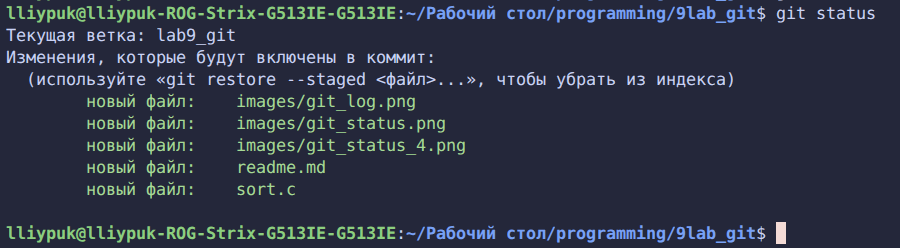
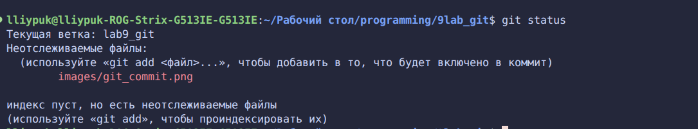

# на 3

1) git status - в результате мы увидели название текущей ветки lab9_git, в ней пока нет индексированых файлов (этот readme заполнялся на момент выполнения команды)

2) git log - текущий указатель HEAD и хэши коммитов с датой создания (на скрине последние коммиты)

4) git status - вывод не поменялся

6) git status - в выводе теперь все вновь добавленные (командой git add .) на момент выполнения файлы

7) git commit - при помощи флага -m добавлено сообщение для коммита

8) git status - снова нет индексированных файлов

9) добавил документацию для метода 

10) git status - отметил, какие файлы не проиндексированы и в каких индексированых есть изменения

11) git add . - проиндексировали все изменённые/добавленные файлы
12) git status - указывают все готовые к коммиту файлы

14) закоммитим изменения

15) т.к. мы не проиндексировали новый коммент в файле + добавиили скринов и пунктов в readme, git status показывает непроиндексированные изменения/новые файлы. git log говорит, что теперь HEAD в последнем коммите

