# на 3

1) git status - в результате мы увидели название текущей ветки lab9_git, в ней пока нет индексированых файлов (этот readme заполнялся на момент выполнения команды)
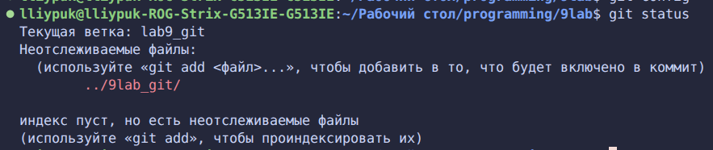
2) git log - текущий указатель HEAD и хэши коммитов с датой создания (на скрине последние коммиты)
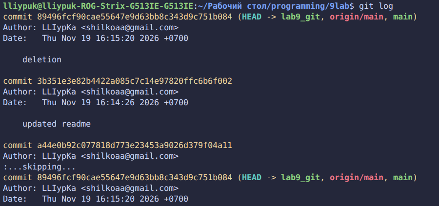
4) git status - вывод не поменялся

6) git status - в выводе теперь все вновь добавленные (командой git add .) на момент выполнения файлы

7) git commit - при помощи флага -m добавлено сообщение для коммита
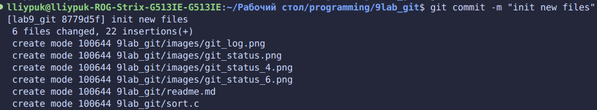
8) git status - снова нет индексированных файлов

9) добавил документацию для метода 
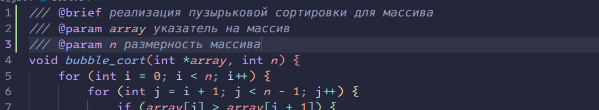
10) git status - отметил, какие файлы не проиндексированы и в каких индексированых есть изменения
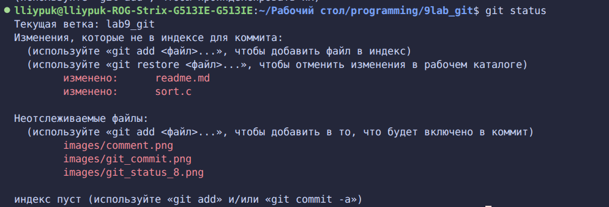
11) git add . - проиндексировали все изменённые/добавленные файлы
12) git status - указывают все готовые к коммиту файлы
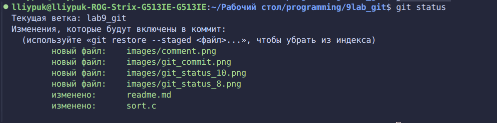
14) закоммитим изменения
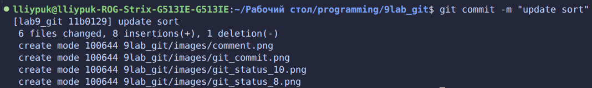
15) т.к. мы не проиндексировали новый коммент в файле + добавиили скринов и пунктов в readme, git status показывает непроиндексированные изменения/новые файлы. git log говорит, что теперь HEAD в последнем коммите
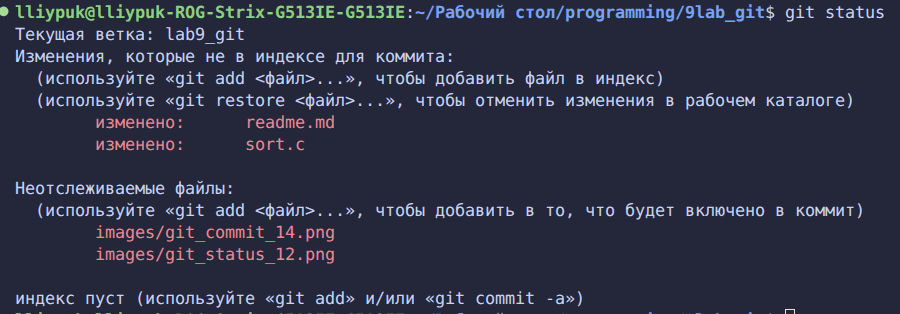
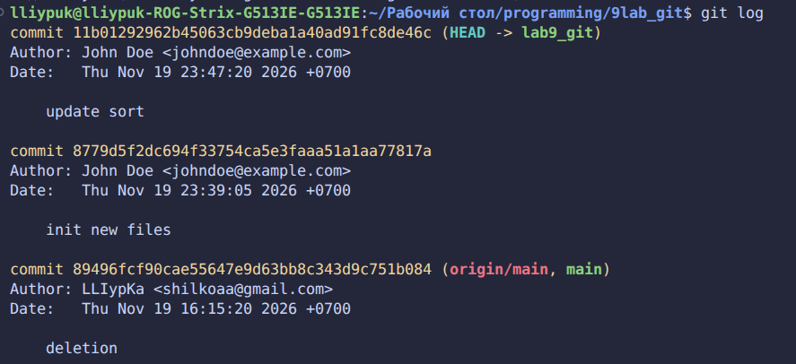
16) 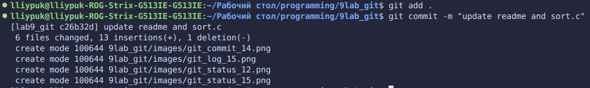
17) git push - укажем в какой репозиторий и в какую ветку запушим изменения и увидем отчёт об операции git_push
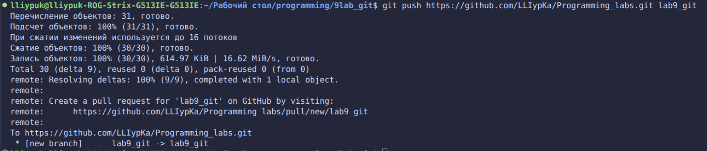
## ветки
1, 2) создадим ветку при помощи git branch и просмотрим список всех веток
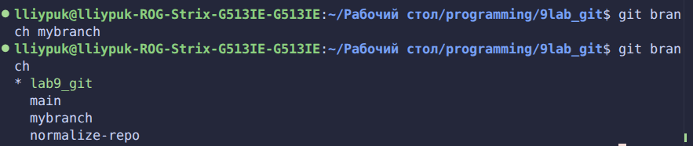 
3) переключимся при помощи git checkout на новую ветку
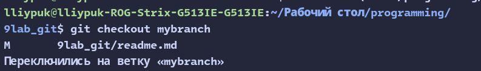
4) git status при переключении на новую векту точно также покажет, какие файлы не проиндексированы. При переключениии на master без индексирования или без использования stash эти файлы перейдут в master и отобразятся как неиндексированные и в mater
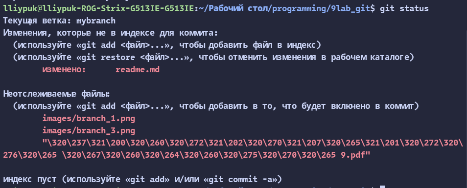
5) это можно сделать при помощи git branch
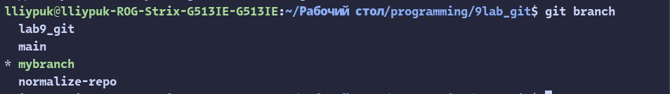
7) git add . + git commit -m
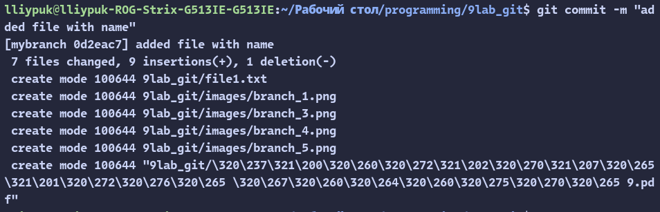
8) head указывает на новую ветку
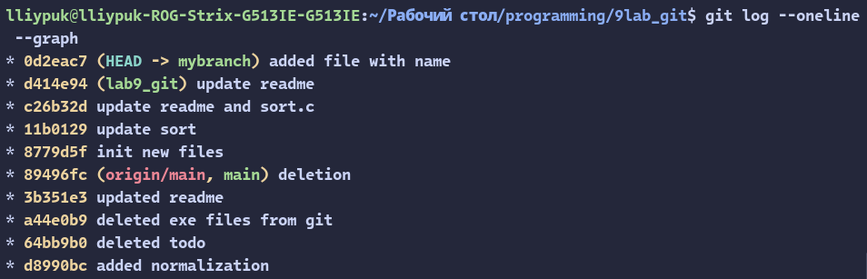
9) git checkout main
10) head указывает на последний коммит в этой ветке
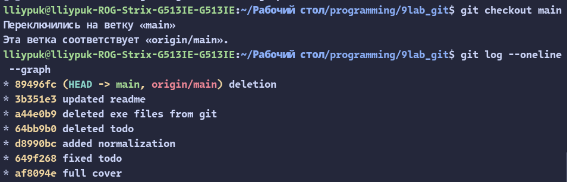
11) git add file1.txt + git commit -m
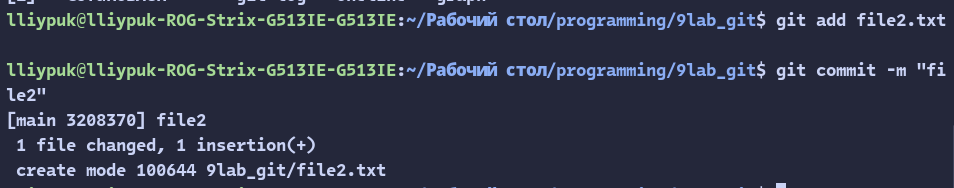
12) теперь мы видим все ветвления репы
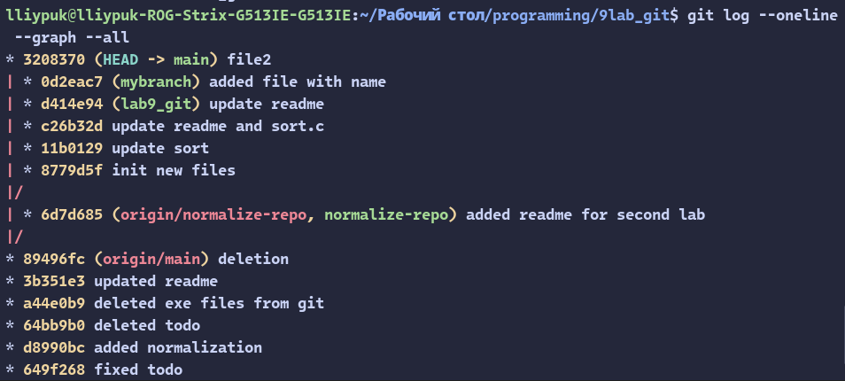
13) git checkout mybranch
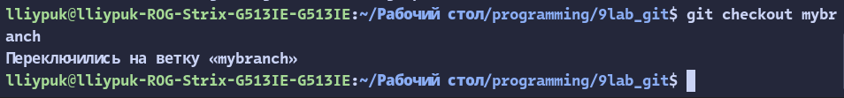
14) да, пропал, т.к. он закоммичен в друой ветке 
15) видно разницув между текстовыми файлами, а также и их отсутствие в ветках mybranch/main
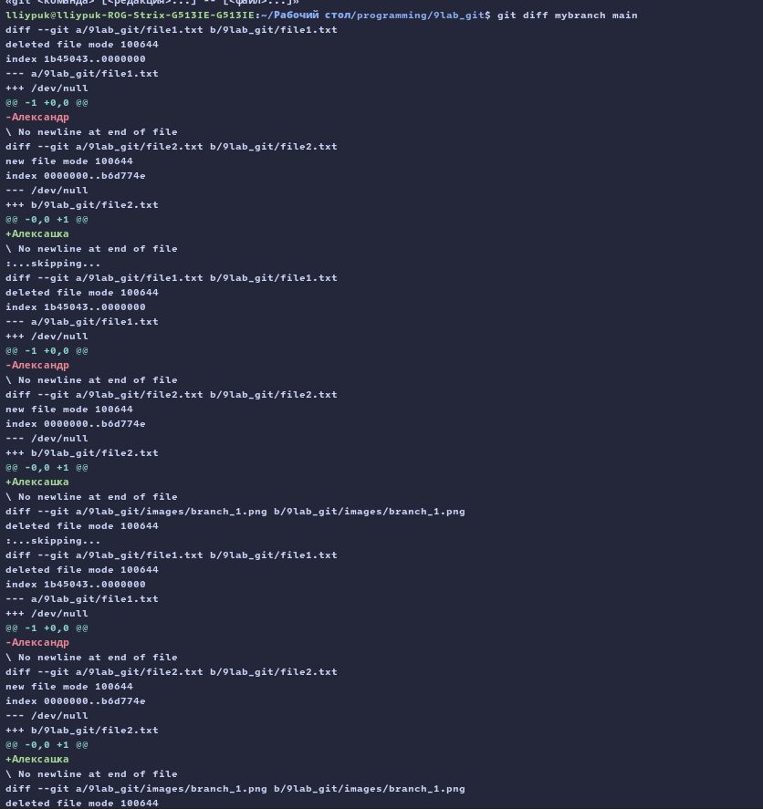
16) 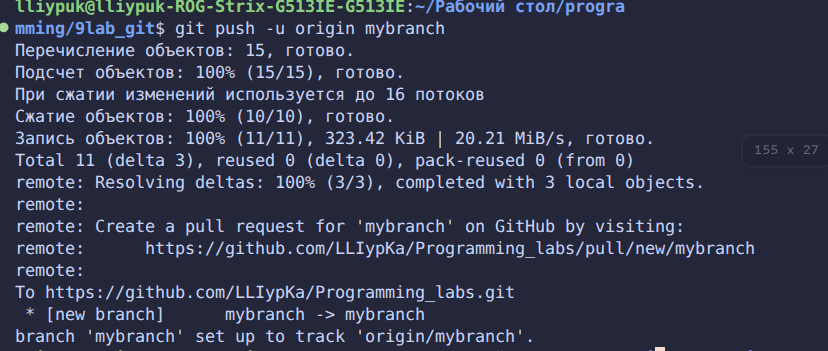
17) 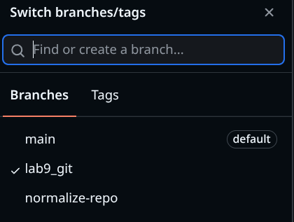

# на 4
1) 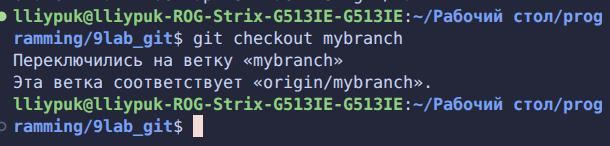
2) 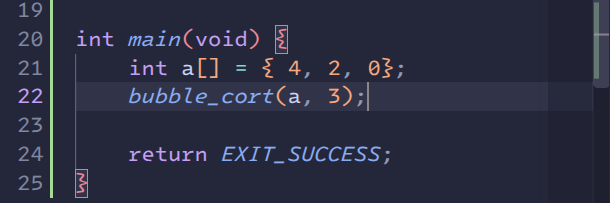
3) видно, были исправления в readme и sort.c
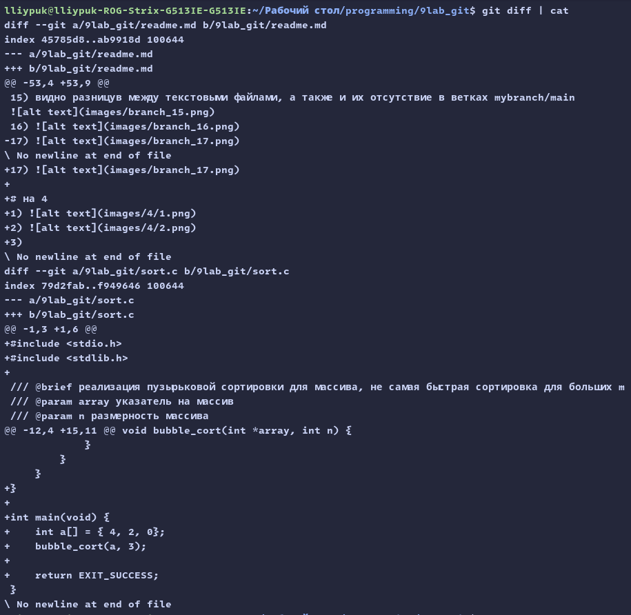
4) да, пустой

5) 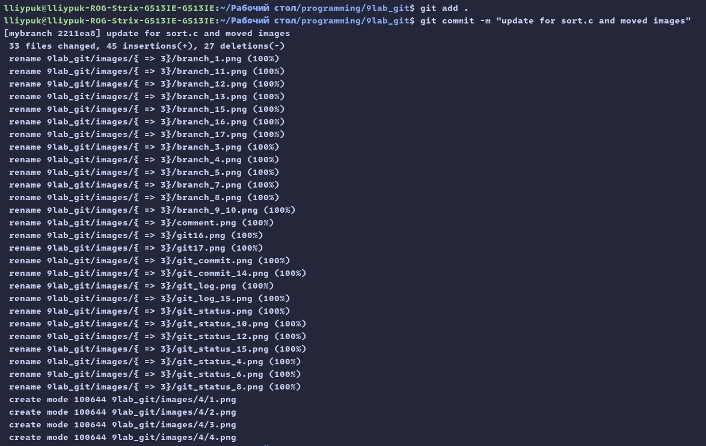
6) он пуст, т.к. все измененя закоммичены
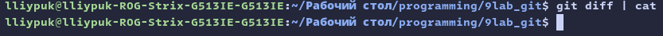
7) тоже пустой
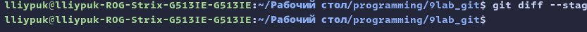
8) 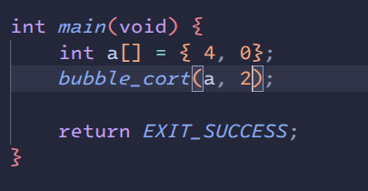
9, 10) git diff показывает все не индексированные изменения, а --staged пока пустой
11) git diff --staged показывает разницу между индексированными изменениями (HEAD vs cureent commit), и. т.к. последние изменения не индексированы, вывод у команды пустой. git diff просто показывает все изменения
12) единственное, два раза файл будет присутствовать в выводе, если проиндексировать изменения
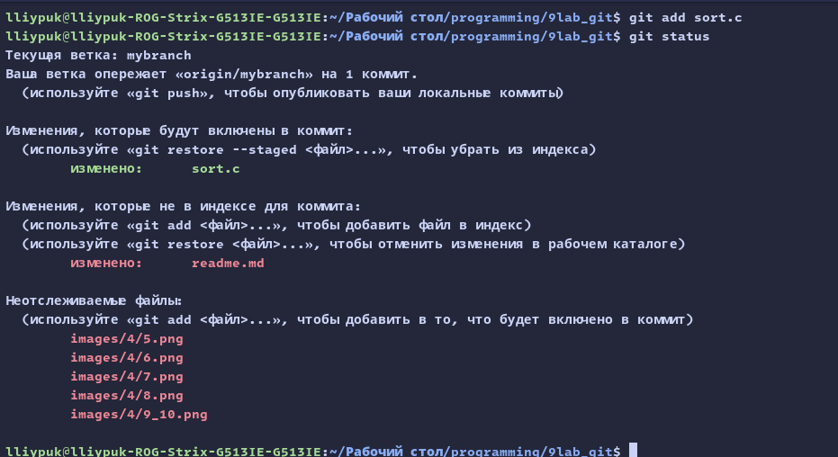
13, 14) теперь видно, что просто существуют изменения в файле sort.c
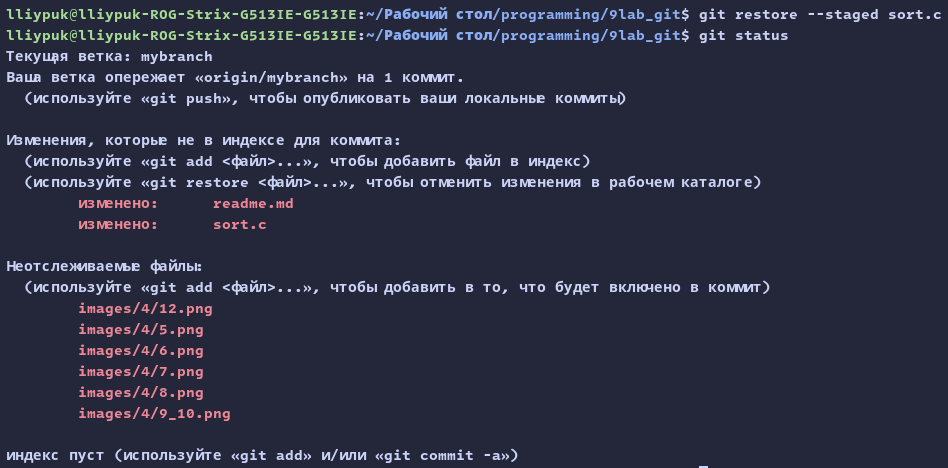