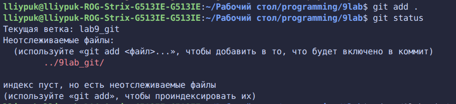

# на 3

1) git status - в результате мы увидели название текущей ветки lab9_git, в ней пока нет индексированых файлов (этот readme заполнялся на момент выполнения команды)

2) git log - текущий указатель HEAD и хэши коммитов с датой создания (на скрине последние коммиты)

4) git status - вывод не поменялся

6) git status - в выводе теперь все вновь добавленные (командой git add .) на момент выполнения файлы
